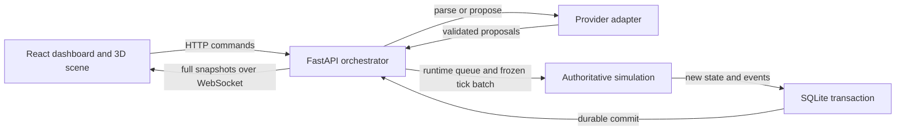

# Architecture

For current v1 rules, action lifetime, usage and database dependencies, see [Simulation engine](simulation-engine.md).

KRONOS has two visible applications: `frontend/` and `backend/`. The backend contains the API, three independently testable modules, and generated contracts. This preserves four-person ownership without a busy repository root.

The engine takes a deep copy, validates actions, and returns a new world with an ordered event batch. It has no database, HTTP, rendering, or provider dependency. API services serialize mutations with an async lock. V1 attempts and results live in the service's runtime queue; committed Events are permanent outcomes. SQLite commits events, latest state, and an immutable checkpoint in one transaction through the unchanged world/event persistence interface. The legacy `actions` table remains database-owned and is unused by the v1 service. Queuing alone never modifies the world. Only after success does the API replace its in-memory state and broadcast. A failed save therefore leaves the active world untouched. Use one uvicorn worker; multi-process writes are outside this local prototype's contract.

Currency uses integer cents. Snapshot state includes the seeded Python RNG state and schema version. Each full checkpoint has a SHA-256 integrity hash for accidental corruption detection, not tamper-proof audit claims. Historical reconstruction reads the recorded checkpoint without resampling randomness or calling AI. Forking is an engine operation that preserves entity IDs/tick/RNG and starts a new branch-local sequence. Original branch records remain untouched.

The browser separates authoritative Zustand snapshots from selection/presentation state. Animated positions, scales, spawn/despawn progress live in Three.js refs. React never updates once per frame. Historical replacement increments an epoch, unmounting active entity animations and placing entities at their saved positions. Movement follows a central lane and plot waypoints. Fast updates converge to the newest position rather than queuing every movement.

Provider calls return JSON through a Pydantic validator, with a timeout and at most two retries. AI sees serialized observations, not mutable engine references. A bounded post-tick strategy budget permits up to eight decisions for food needs, incoming offers, or a third-day conversation. The model works outside the world lock and its output is queued for a later tick. Failed strategy calls skip the strategy and allow daily mechanics to continue; user parse failures return 422. Model/env knobs are reserved for adapters; the bundled mock needs no key.

## Extension points

- Frontend: split or replace `world/Village.tsx` entity geometry without editing transport. Add presentation queues without changing authoritative snapshots.
- Engine: add typed actions and event variants, validate preconditions, and test conservation and rejection behavior before API integration.
- Agents: implement `LLMProvider.complete(task, observation)` and explicitly wire provider selection in `Service`; enforce citizen identity and observation scope.
- History/API: add migrations, checkpoint retention, branch comparison, and event query pagination before expanding persistence complexity.

No shadcn dependency is needed for this first screen: native accessible buttons, selects, range input, and details keep controls small. Tailwind is available alongside the shared CSS design tokens. No router or external models are required.
